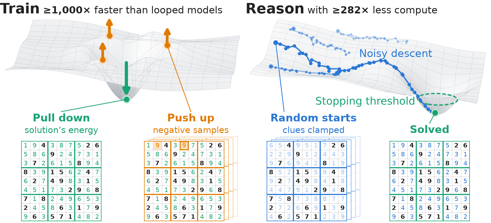

<p align="center">
  <a href="https://prefrontal.ai">
    <picture>
      <source media="(prefers-color-scheme: dark)" srcset="assets/prefrontal-logo-dark.svg">
      
    </picture>
  </a>
</p>

<h1 align="center">CRAM: Compact Reasoning Associative Memory</h1>

<p align="center">
  <a href="https://arxiv.org/pdf/2611.17309"></a>
  <a href="https://prefrontal.ai/news/cram/"></a>
  <a href="LICENSE"></a>
  
  
</p>

<p align="center">
  📄 <a href="https://arxiv.org/pdf/2611.17309"><b>Paper</b></a> &nbsp;·&nbsp;
  📝 <a href="https://prefrontal.ai/news/cram/"><b>Blog post</b></a> &nbsp;·&nbsp;
  🚀 <a href="#quickstart"><b>Quickstart</b></a> &nbsp;·&nbsp;
  🔁 <a href="REPRODUCING.md"><b>Reproduce</b></a> &nbsp;·&nbsp;
  🤖 <a href="AGENTS.md"><b>Agents</b></a> &nbsp;·&nbsp;
  🔖 <a href="#citation"><b>Cite</b></a>
</p>

**Big reasoning speedups: 1,000× faster training and 280× less compute than any looped model.**

CRAM (Compact Reasoning Associative Memory) is a fully trainable energy-based model from the 1980s: the energy of Hopfield and Tank, with its weights learned from solved puzzles.
Reasoning is descent on that energy, and the energy tells the search when to stop.



| Task | Test puzzles solved | Parameters | Training time (one GPU) |
| --- | --- | --- | --- |
| Sudoku-Extreme | 99.996% | 263,169 (about 7,700 nonzero) | 42 ms |
| Maze-Unique | 100% | 18 | 132 ms |

Paper: "Classical Energies Learn to Reason 1,000× Faster than Looped Models", Benjamin Hoover, Hugh Blayney and James C. R. Whittington (Prefrontal), arXiv 2611.17309.

## Quickstart

Needs one NVIDIA GPU and [uv](https://docs.astral.sh/uv/).

```sh
uv sync                                                                    # environment
uv run python scripts/prepare_data.py sudoku                               # data
uv run python scripts/prepare_data.py maze-unique
uv run python checkpoints/evaluate.py --tasks sudoku-extreme maze-unique   # score the paper's trained models
```

Train from scratch (under a second per model):

```sh
cd experiments
uv run python sudoku.py diag
uv run python maze_unique.py train --kernel free --free-init 0 --opt sgd --momentum 0.5 --cosine --lr 1 --updates 20 --l1 0 --split train --out runs/demo --score
```

- The trained weights of every model in the paper are in [`checkpoints/`](checkpoints/README.md).
- The commands behind every table and figure are in [`REPRODUCING.md`](REPRODUCING.md).
- Notes for coding agents are in [`AGENTS.md`](AGENTS.md).
- The baselines are in [`baselines/`](baselines/README.md).

## Citation

```bibtex
@article{hoover2026cram,
  title         = {Classical Energies Learn to Reason 1,000x Faster than Looped Models},
  author        = {Hoover, Benjamin and Blayney, Hugh and Whittington, James C. R.},
  year          = {2026},
  journal       = {arXiv preprint arXiv:2611.17309},
  eprint        = {2611.17309},
  archivePrefix = {arXiv},
  url           = {https://arxiv.org/abs/2611.17309}
}
```

## License

Apache License 2.0. See `LICENSE`.
